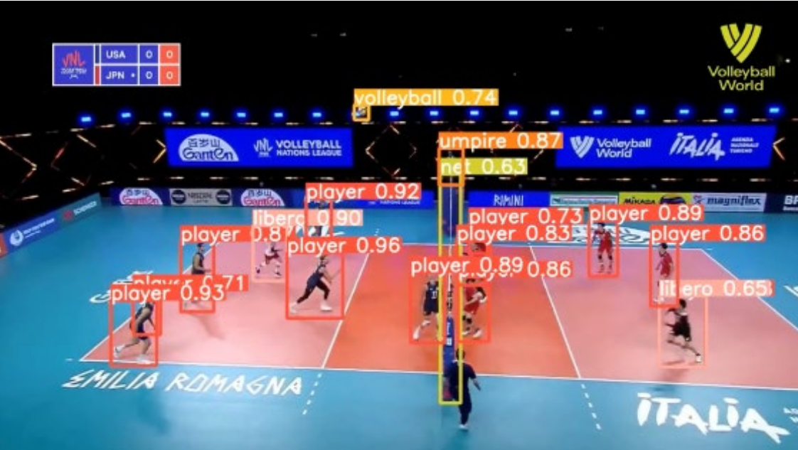
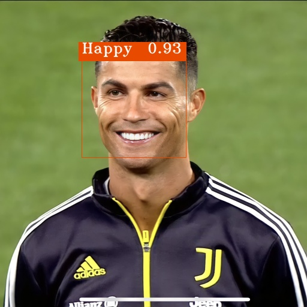
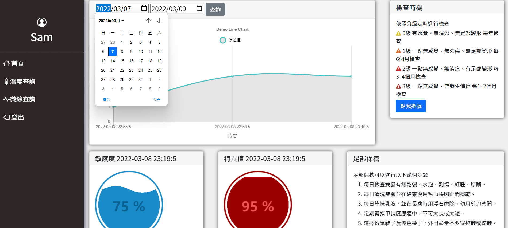
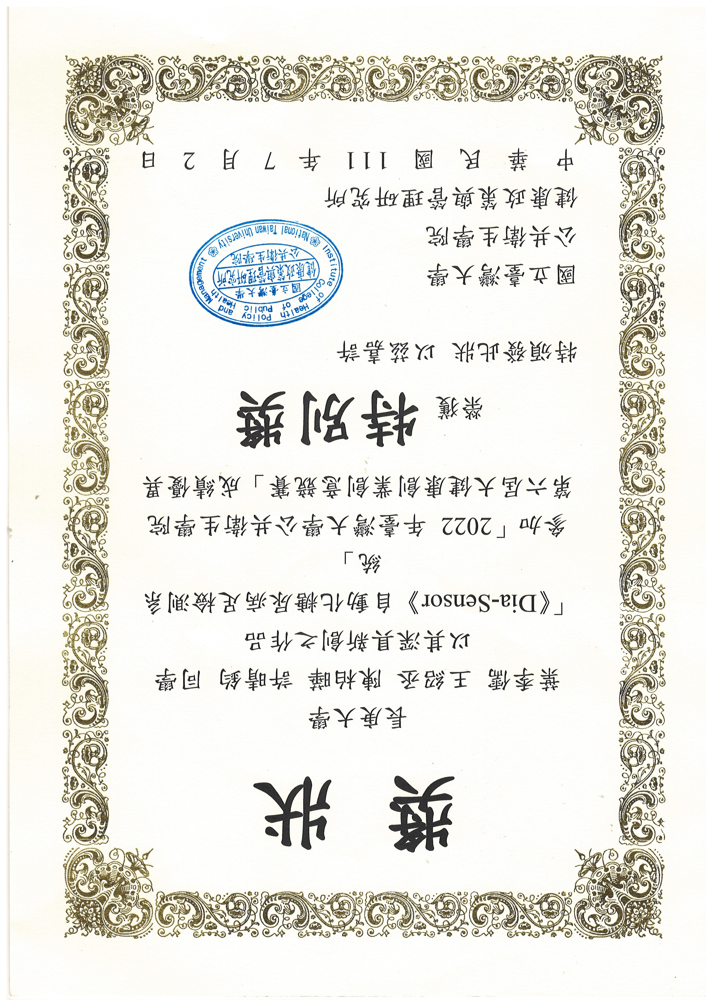

<blockquote>

刷刷LeetCode，做做設計，炒炒股票。 充實自己向前邁進。

</blockquote>
<link href="styles.css" rel="stylesheet" />

## <a target="_blank" rel="noopener" href="https://www.canva.com/design/DAFMR2Im3-U/3Y3j0CMwJm4dwWAE3Q8i_A/view?utm_content=DAFMR2Im3-U&amp;utm_campaign=designshare&amp;utm_medium=link&amp;utm_source=publishsharelink">個人簡歷請按我</a>## 學歷
<h5>

2023-present
 
國立臺灣科技大學 資訊工程學碩士
 <ul> <!-- <li>110-2 書卷4</li> --> </ul></h5><h5>

2019-2023
 
長庚大學 資訊工程學系
 <ul> <li>系排2(3.4%)</li> </ul></h5>

## 工作經歷

<h5>Jul 2022 - Aug 2022</h5><h4><a target="_blank" rel="noopener" href="https://www.mathison.com.tw/">麥錫森智能科技股份有限公司</a></h4>
<strong><strong><strong><strong>____</strong></strong></strong></strong>

爬蟲抓取證卷交易所與金融新聞資料

ckiptagger、word2Vec、GRU、finBert

分析重大消息與財報對股價影響之關係
 

<h5>Aug 2021 - Aug 2022</h5><h4><a target="_blank" rel="noopener" href="https://www.tsmc.com/chinese">台灣積體電路製造股份有限公司</a></h4>
<strong><strong><strong><strong>____</strong></strong></strong></strong>

從事台積電產學合作相關事宜

web開發、line service

台積電專案主管指派之工作
 

 

<h5>Jul 2020 - Jul 2022</h5><h4><a target="_blank" rel="noopener" href="https://www.cgu.edu.tw/">長庚大學研究助理</a></h4>
<strong><strong><strong><strong>____</strong></strong></strong></strong>

參予過兩項計畫案

1.長庚大學弱勢學生接受獎補助之正向經驗探究

2.基於異質計算核心與異質記憶體資源之效能與可靠度提升機制
 

<h5>Oct 2021 - Jun 2022</h5><h4><a target="_blank" rel="noopener" href="https://www.cgu.edu.tw/">長庚大學課輔老師</a></h4>
<strong><strong><strong><strong>____</strong></strong></strong></strong>

課業輔導資工系的學弟妹

資料結構、網頁設計、演算法

c++、react、python
 
 

## 比賽<h5><a target="_blank" rel="noopener" href="https://www.wellnewss.com/post/400131.html">2023總統教育獎</a></h5> <h5><a target="_blank" rel="noopener" href="https://mobilehero.com/zh-Hant/fivegplus">5G領航創新應用競賽 初賽入圍</a> 
如影隨行 - 《SPARK VIDEO 運動影像辨識與音樂生成暨應用》

建立串流平台，讓使用者能上傳自己的運動類型影片又或者運動賽事影片，透過我們系統的球員臉部表情辨識、動作判定、觀眾聲音情感分析抓出精彩片段並加上合適的配樂回傳給使用者，並且能讓使用者互相分享AI剪輯後的影片。

</h5> <h5><a target="_blank" rel="noopener" href="https://bhuntr.com/tw/competitions/ahoiag0vx7eoa3inb4">台大大健康創業創意競賽特別獎</a> 
《DIA-SENSOR》自動化糖尿病足檢測系統

為解決傳統糖尿病足檢測之問題，我們開發一個系統讓糖尿病患者可輕鬆在家中完成檢測，並自動將資料上傳到雲端，醫生可遠端通過瀏覽器輕易察看檢測結果與分析，簡化醫病雙方的使用流程，提供糖尿病患者足部神經病變的預防及篩檢。

</h5> <h5><a target="_blank" rel="noopener" href="https://www.foxconnfoundation.org/plan/scholarship/focus_report">鴻海獎學鯨第六屆、第五屆、第四屆得主</a></h5> <h5><a target="_blank" rel="noopener" href="https://www.taipeifubon.org.tw/news/inside/130">第十屆富邦才藝獎決賽入圍</a></h5> <h5><a target="_blank" rel="noopener" href="https://www.edu.tw/News_Content.aspx?n=9E7AC85F1954DDA8&amp;s=B668479672DF15F3">2016總統教育獎</a></h5>

## 相關報導<h5> 中時新聞網  <a target="_blank" rel="noopener" href="https://www.chinatimes.com/realtimenews/20230519004560-260405?chdtv">拒當躺平族！ 長庚大學王紹丞二度獲總統教育獎</a>  經濟日報 <a target="_blank" rel="noopener" href="https://money.udn.com/money/story/5723/7176815">拒當「躺平族」 長庚大學王紹丞克服困境再獲2023總統教育獎</a>  桃園電子報  <a target="_blank" rel="noopener" href="https://tyenews.com/2023/05/384173/">不向命運低頭！長庚大學王紹丞二度獲總統教育獎 盼回饋社會</a>  民視新聞網  <a target="_blank" rel="noopener" href="https://www.ftvnews.com.tw/news/detail/2023519W0182">不向命運低頭！長庚大學王紹丞二度獲總統教育獎　盼回饋社會</a>  ETtoday新聞雲  <a target="_blank" rel="noopener" href="https://www.ettoday.net/news/20220702/2285772.htm">防阿嬤的腳沒感覺　長庚大學生開發自動化糖尿病足檢測系統</a>  The Central News Agency 中央通訊社  <a target="_blank" rel="noopener" href="https://tw.news.yahoo.com/%E9%95%B7%E5%BA%9A%E5%A4%A7%E5%AD%B8%E5%9C%98%E9%9A%8A%E9%96%8B%E7%99%BC%E8%87%AA%E5%8B%95%E5%8C%96%E7%B3%96%E5%B0%BF%E7%97%85%E8%B6%B3%E6%AA%A2%E6%B8%AC%E7%B3%BB%E7%B5%B1-%E5%9C%96-082705597.html">長庚大學團隊開發自動化糖尿病足檢測系統 (圖)</a>  Yahoo 新聞  <a target="_blank" rel="noopener" href="https://tw.stock.yahoo.com/news/%E9%80%A0%E7%A6%8F%E7%B3%96%E5%B0%BF%E7%97%85%E6%82%A3-%E9%95%B7%E5%BA%9A%E7%94%9F%E9%96%8B%E7%99%BC%E6%AA%A2%E6%B8%AC%E7%B3%BB%E7%B5%B1-095610505.html">造福糖尿病患！長庚生開發檢測系統</a>  NOWnews 今日新聞  <a target="_blank" rel="noopener" href="https://www.nownews.com/news/5857301">造福糖尿病患！長庚生開發「自動化病足檢測系統」</a>  PacificENews  <a target="_blank" rel="noopener" href="https://pacificenews.com/2022/07/04/%E8%87%BA%E5%A4%A7%E5%81%A5%E5%BA%B7%E5%89%B5%E6%84%8F%E7%AB%B6%E8%B3%BD-%E8%AE%93%E5%8B%87%E9%97%96%E5%89%B5%E6%96%B0%E8%80%85%E5%AF%A6%E8%B8%90%E5%A4%A2%E6%83%B3%E7%BF%BB%E8%BD%89%E6%9C%AA%E4%BE%86/">臺大健康創意競賽 讓勇闖創新者實踐夢想翻轉未來！…</a>  udn 聯合新聞網  <a target="_blank" rel="noopener" href="https://udn.com/news/story/7266/6432200">可偵測腸病毒的尿布 台大公衛大健康創業創意競賽揭曉</a> </h5>

## 程式語言<ul>
<li>c/c++</li>
<li>python </li>
<li>php</li>
<li>html/css/js</li>
<li>react</li>
</ul>
## 紀錄片<iframe src="https://www.facebook.com/plugins/video.php?height=314&href=https%3A%2F%2Fwww.facebook.com%2Ffeelstory8%2Fvideos%2F264930624231716%2F&show_text=false&width=560&t=0" width="320" height="160" style="border:none;overflow:hidden" scrolling="no" frameborder="0" allowfullscreen="true" allow="autoplay; clipboard-write; encrypted-media; picture-in-picture; web-share" allowFullScreen="true"></iframe>
